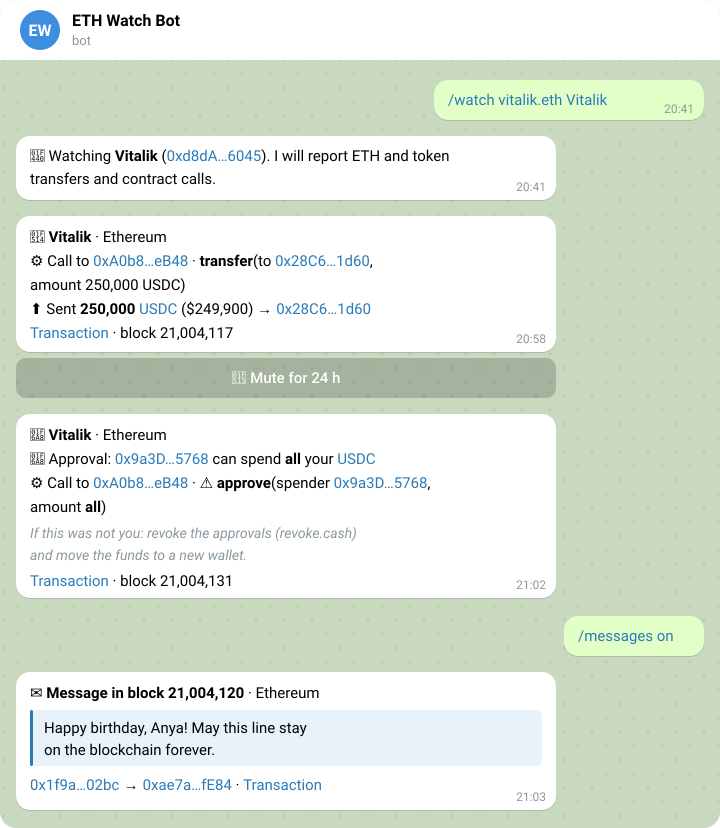
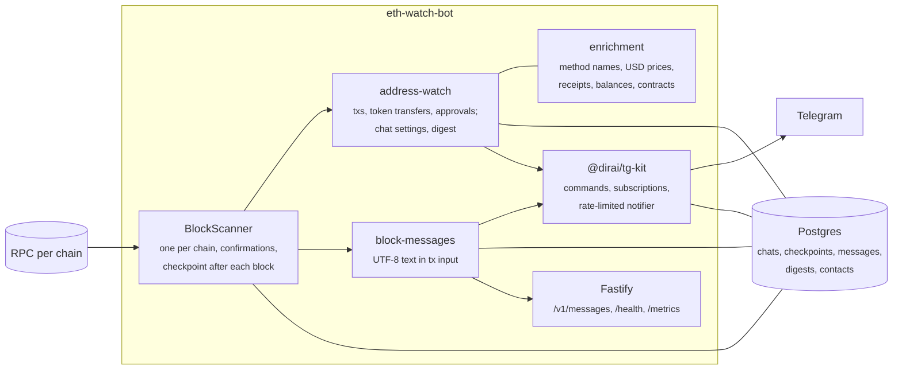

<div align="center">

# ETH Watch Bot

A Telegram bot that watches EVM addresses and relays the text messages people write in transactions.
Ethereum, Base, Arbitrum and Optimism.

[](https://github.com/DiRaiks/eth-watch-bot/actions/workflows/ci.yml)
[](package.json)
[](https://github.com/DiRaiks/tg-bot-kit)
[](https://viem.sh)

</div>

<p align="center">
  <picture>
    <source media="(prefers-color-scheme: dark)" srcset="docs/chat-en-dark.svg" />
    
  </picture>
</p>

Watch your own wallets and learn about any transaction you did not make. Add the bot to a chat and send `/watch 0x…`: from then on the chat hears about every transfer of ETH, tokens and NFTs, every contract call, and every approval that lets someone else spend your tokens. Turn on `/messages` to also see the notes people leave in transaction data: birthday wishes, love letters, pleas to hackers, on-chain graffiti.

Each chat gets English or Russian: the user's Telegram language, or the one chosen in `/settings`; `LANGUAGE` sets the default. The picture shows its real English texts: the first alert with details shown, the second as by default, under a spoiler.

## Features

- **Addresses and ENS names.** `/watch 0x…` or `/watch vitalik.eth`, with an optional label. Any letter case works.
- **Everything an address does.** ETH, ERC-20, ERC-721 and ERC-1155 transfers in and out, contract calls (also those that send ETH, such as staking), contract creation. One message per transaction, however many watched addresses it touches, with amounts in dollars.
- **What the transaction did and cost.** A failed transaction is marked as such: nothing moved, the fee was paid. Outgoing transactions show their fee in ETH and dollars, with the L1 fee of Base and Optimism; the message also gives the ETH balance after the block and the block time in the chat's time zone.
- **Who is on the other side.** Well-known contracts (Lido, WETH, Permit2) appear by name, other contracts are marked as contracts, and a recipient or spender the address has never paid or approved before is marked 🆕 first time, the usual sign of address poisoning. Only the owner's own transactions count, so a forged event cannot make a look-alike familiar; the bot knows contacts from the moment it starts watching.
- **Private at a glance.** The first line of an alert names only the address, the chain and the event (outgoing, incoming, token approval, taken without you). Amounts, addresses and the link sit under a spoiler, so the chat list and a glance at the screen show nothing more; `/settings` can show them openly.
- **Signs of a compromised wallet.** 🚨 alerts for token approvals (unlimited ones called out), Permit2 allowances granted by signing a message, collection-wide NFT approvals, and tokens that leave the wallet in a transaction someone else sent: the way drainers empty wallets. Alerts get through mutes, muted chains, quiet hours, thresholds and the digest, and say what to do next; approval alerts link to revoke.cash for the address and chain.
- **No panic over forgeries.** Any contract can emit an event that names your address. An alarming event about a token you never held, with no market price, is shown as a likely fake instead of an alert. The allowance a swap spends is not reported as a new approval.
- **Address poisoning.** Zero-value "transfers" from your address to a look-alike one are marked as fake, so you do not copy the attacker's address from your history.
- **Readable contract calls.** Common methods are named from a built-in list; others come from the public signature database, only from verified contracts, and are shown as a hint since anyone can register a name. The call's parameters are decoded too: `transfer(to 0x28C6…1d60, amount 250,000 USDC)`, `approve(spender 0x9a3D…5768, amount all)`. Token amounts use the token's decimals, addresses link to the explorer, long values are shortened; parameter names are shown only for built-in methods. Calldata that does not fit the signature falls back to the name alone.
- **Several chats, one address.** Every chat watching an address gets its own notification.
- **Mute from the message.** A button under each notification silences the address for 24 hours; another brings it back.
- **Settings per chat.** `/settings`: which chains, a dollar threshold for incoming transfers, quiet hours in the chat's time zone (messages arrive without a sound; alerts still ring), spam shown with a warning or hidden, a daily digest instead of a message per incoming transaction, details under a spoiler or shown, and the chat's language. The digest comes at 09:00 in the chat's time zone (Moscow until changed in `/settings`); the hour itself is fixed.
- **Several RPCs per chain.** List free RPCs comma-separated: when one fails or hits its limits, the next answers, and the first is preferred again once it is back. An RPC of another network in the list is left out at start.
- **No missed or repeated blocks.** Each chain is scanned block by block after a few confirmations. Progress is saved after every block, so a restart or an RPC outage resumes where it stopped. After a long outage (over `MAX_LAG_BLOCKS`) it skips to recent blocks instead of replaying stale alerts.
- **Readable messages only.** Text in transaction data is checked for real words; calldata, inscriptions, swap memos and ids are skipped. Each message is posted once, and the same text mailed by one sender to many addresses is posted once with the number of recipients.
- **Flood guard.** Above five alerts for one chat, or five messages, in a block, the rest comes as a single summary. Token symbols are shown only when they look like tickers, so spam tokens cannot inject text.
- **English or Russian, per chat.** Replies follow the user's Telegram language until the chat picks one in `/settings`; alerts and the digest use the chat's language, saved on the first `/watch`. `/start` and `/help` follow the same rule; the command menu is in English and Russian, picked by the user's Telegram app language. `LANGUAGE=en` (default) or `LANGUAGE=ru` is for chats that have not chosen one and users of other languages.
- **HTTP API.** `GET /v1/messages` returns recent messages; `GET /health` reports every chain's lag and the Telegram connection. It always answers 200, so an RPC outage does not restart the container: Docker's "healthy" means the process is up, and `status` in the body (`ok` or `degraded`) tells whether the chains and Telegram are fine.
- **Prometheus metrics.** `GET /metrics`: scanner progress and lag per chain, notifications by importance, messages found, Telegram updates and deliveries (from tg-kit), and process metrics. The public proxy does not route it; scrape it inside the network.

## Commands

| Command                         | Who                       | What                                                                                 |
| ------------------------------- | ------------------------- | ------------------------------------------------------------------------------------ |
| `/watch <address\|ens> [label]` | chat admins               | Watch an address, or change its label                                                |
| `/unwatch <address\|label>`     | chat admins               | Stop watching                                                                        |
| `/list`                         | everyone                  | Watched addresses and their mute state                                               |
| `/settings`                     | chat admins               | Chains, threshold, quiet hours, spam, digest, details, language                      |
| `/messages on\|off`             | chat admins               | Messages from transaction data                                                       |
| `/status`                       | everyone                  | What this chat follows, how each chain is doing                                      |
| `/stats`                        | bot admins (`BOT_ADMINS`) | Chats, addresses, subscribers, chains                                                |
| `/health`                       | bot admins (`BOT_ADMINS`) | Uptime, memory, database, Telegram, chains with their RPC, notifications since start |
| `/help`                         | everyone                  | Command list                                                                         |

In private chats everyone counts as an admin. In groups and channels it takes a chat admin, both for commands and for the mute buttons.

## How it works



Transactions sent for you by a relayer, a smart account or a Safe (CoW Swap and UniswapX fills, ERC-4337 bundlers) also move tokens "in someone else's transaction" and raise the same alert: check the transaction before you panic.

What the bot cannot see: ETH moved by a contract on your behalf (internal transactions) appears only through the call that caused it, and Permit2 allowances show up as the approval to Permit2 plus the transfers they lead to.

Chats and their watched addresses are stored by [@dirai/tg-kit](https://github.com/DiRaiks/tg-bot-kit)'s subscription store; the bot keeps an in-memory index by address so every transaction is a map lookup. When no chat watches anything and no chain is searched for messages, scanners skip ahead without downloading blocks.

## Run locally

```bash
cp .env.example .env    # set RPC_URL_ETHEREUM, and BOT_TOKEN to talk to Telegram
npm install
npm run dev
```

Without `BOT_TOKEN` notifications go to the log, and without `DATABASE_URL` everything lives in memory, so a public RPC is enough to try it. A local Postgres:

```bash
docker run -d --name eth-watch-postgres -p 5432:5432 -e POSTGRES_PASSWORD=postgres -e POSTGRES_DB=eth_watch postgres:18-alpine
```

## Configuration

| Variable                                                              | Default                   | Description                                                                                                                                                                                                                           |
| --------------------------------------------------------------------- | ------------------------- | ------------------------------------------------------------------------------------------------------------------------------------------------------------------------------------------------------------------------------------- |
| `RPC_URL_ETHEREUM`, `_BASE`, `_ARBITRUM`, `_OPTIMISM`                 |                           | Chains with an RPC URL are scanned; at least one is required. Several URLs, comma-separated, are tried in order: a failing one hands over to the next. URLs of another network are left out at start. `/health` shows the host in use |
| `RPC_URL`                                                             |                           | Legacy name of `RPC_URL_ETHEREUM`, used when that one is not set                                                                                                                                                                      |
| `CONFIRMATIONS_<CHAIN>`                                               | 3 / 10 / 20 / 10          | Blocks to wait before reporting (Ethereum / Base / Arbitrum / Optimism)                                                                                                                                                               |
| `MESSAGES_CHAINS`                                                     | `ethereum`                | Chains searched for text messages; empty (`,`) turns them off                                                                                                                                                                         |
| `BOT_TOKEN`                                                           |                           | Telegram bot token; without it notifications are logged                                                                                                                                                                               |
| `BOT_MODE`                                                            | `polling`                 | `polling` or `webhook` (needs `BOT_WEBHOOK_URL`, `BOT_WEBHOOK_SECRET`)                                                                                                                                                                |
| `BOT_ADMINS`                                                          |                           | Telegram user ids allowed to run `/stats` and `/health`                                                                                                                                                                               |
| `DATABASE_URL`                                                        |                           | Postgres connection string; tables are created on start. In memory without it, required in production                                                                                                                                 |
| `POLL_INTERVAL_MS`, `MAX_BLOCKS_PER_TICK`                             | `4000`, `50`              | Scanner pace and catch-up batch                                                                                                                                                                                                       |
| `MAX_LAG_BLOCKS`                                                      | `1000`                    | Further behind than this, old blocks are skipped                                                                                                                                                                                      |
| `LANGUAGE`                                                            | `en`                      | Default language, `en` or `ru`: of chats that have not chosen one, and of the command menu for other Telegram languages                                                                                                               |
| `PRICES`                                                              | `true`                    | Dollar amounts from DefiLlama; `false` keeps the bot off third-party APIs                                                                                                                                                             |
| `SIGNATURE_LOOKUP`                                                    | `true`                    | Method names from the openchain database for selectors not built in                                                                                                                                                                   |
| `MAX_WATCHES_PER_CHAT`                                                | `20`                      | Addresses per chat                                                                                                                                                                                                                    |
| `PORT`, `HOST`, `LOG_LEVEL`                                           | `3000`, `0.0.0.0`, `info` | HTTP server; under Docker Compose `PORT` from `.env` is ignored (always 3000)                                                                                                                                                         |
| `TRUST_PROXY`, `CORS_ORIGINS`                                         | `0`                       | Proxy hops in front of the app; browser origins allowed to call the API                                                                                                                                                               |
| `DEFAULT_CHANNEL_ID`, `DEFAULT_ADDRESSES`, `DEFAULT_CHANNEL_MESSAGES` |                           | A chat set up on start: the setup of the old bots keeps working. Each default address is added once; one removed with `/unwatch` stays removed after a restart                                                                        |

Fast chains mean many blocks: Arbitrum makes about four a second, and each watched block costs two RPC calls. Use an RPC plan that fits, or leave the chain out.

## HTTP API

```bash
curl 'http://localhost:3000/v1/messages?limit=5'
```

```json
{
  "messages": [
    {
      "chain": "ethereum",
      "blockNumber": 21004120,
      "hash": "0x…",
      "from": "0x…",
      "to": "0x…",
      "text": "Happy birthday, Alice. This one is forever.",
      "timestamp": 1761400000,
      "url": "https://etherscan.io/tx/0x…"
    }
  ]
}
```

`limit` is 1 to 100 (default 20), 60 requests a minute per client. Messages are kept for 90 days.

## Deploy

One VPS with Docker Compose: the bot, plus optional Caddy for HTTPS (webhook and public API) and an optional local Postgres with daily backups. After CI passes on `main`, the image is built and pushed to GHCR; the deploy step stays skipped until the server is configured. See [deploy/README.md](deploy/README.md).

## Development

```bash
npm test               # unit and integration tests, Postgres in memory (PGlite)
npm run test:coverage
npm run lint && npm run format && npm run types
```

Tests drive the whole bot through a fake Telegram API and an in-memory chain: commands, notifications, mute buttons, repeated and missed blocks.

## History

This repository, formerly `eth_monitoring_bot` (address alerts), merges it with [`eth_messages_bot`](https://github.com/DiRaiks/eth_messages_bot) (messages in blocks, now archived), whose history was imported into this one. The rewrite fixed what they got wrong: chats were lost on restart, addresses were compared case-sensitively, only one chat got each alert, messages could repeat, `/chats` showed every chat id to anyone, and the Docker image carried the bot token.

## License

[MIT](LICENSE)
