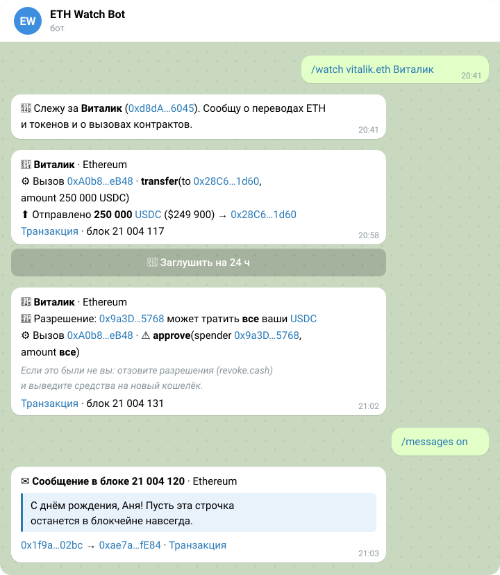
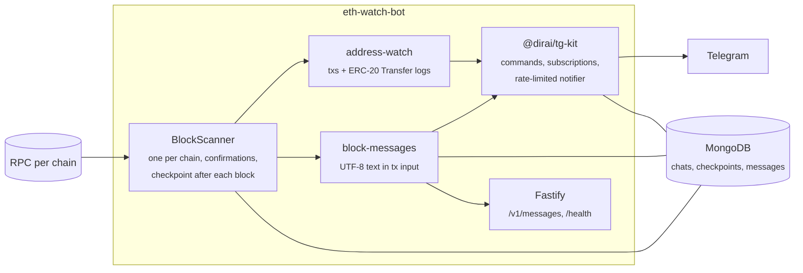

<div align="center">

# ETH Watch Bot

A Telegram bot that watches EVM addresses and relays the text messages people write in transactions.
Ethereum, Base, Arbitrum and Optimism.

[](https://github.com/DiRaiks/eth-watch-bot/actions/workflows/ci.yml)
[](package.json)
[](https://github.com/DiRaiks/tg-bot-kit)
[](https://viem.sh)

</div>

<p align="center">
  <picture>
    <source media="(prefers-color-scheme: dark)" srcset="docs/chat-dark.svg" />
    
  </picture>
</p>

Add the bot to a chat and send `/watch vitalik.eth`. From then on the chat gets a message whenever the address moves ETH or tokens or calls a contract, with a button to mute it for a day. Turn on `/messages` to also see the notes people leave in transaction data: birthday wishes, love letters, pleas to hackers, on-chain graffiti.

The bot speaks Russian; the picture shows its real texts.

## Features

- **Addresses and ENS names.** `/watch 0x…` or `/watch vitalik.eth`, with an optional label. Any letter case works.
- **Everything an address does.** Native transfers, ERC-20 transfers in and out, contract calls with the method selector, contract creation. One message per transaction, however many watched addresses it touches.
- **Several chats, one address.** Every chat watching an address gets its own notification.
- **Mute from the message.** A button under each notification silences the address for 24 hours; another brings it back.
- **No missed or repeated blocks.** Each chain is scanned block by block after a few confirmations. Progress is saved after every block, so a restart or an RPC outage resumes where it stopped. After a long outage (over `MAX_LAG_BLOCKS`) it skips to recent blocks instead of replaying stale alerts.
- **Readable messages only.** Text in transaction data is checked for real words; calldata, inscriptions, swap memos and ids are skipped. Each message is posted once, and the same text mailed by one sender to many addresses is posted once with the number of recipients.
- **Flood guard.** Above five alerts for one chat, or five messages, in a block, the rest comes as a single summary. Token symbols are shown only when they look like tickers, so spam tokens cannot inject text.
- **HTTP API.** `GET /v1/messages` returns recent messages; `GET /health` reports every chain's lag.

## Commands

| Command                         | Who                       | What                                            |
| ------------------------------- | ------------------------- | ----------------------------------------------- |
| `/watch <address\|ens> [label]` | chat admins               | Watch an address, or change its label           |
| `/unwatch <address\|label>`     | chat admins               | Stop watching                                   |
| `/list`                         | everyone                  | Watched addresses and their mute state          |
| `/messages on\|off`             | chat admins               | Messages from transaction data                  |
| `/status`                       | everyone                  | What this chat follows, how each chain is doing |
| `/stats`                        | bot admins (`BOT_ADMINS`) | Chats, addresses, subscribers, chains           |
| `/help`                         | everyone                  | Command list                                    |

In private chats everyone counts as an admin. In groups and channels it takes a chat admin, both for commands and for the mute buttons.

## How it works



Chats and their watched addresses are stored by [@dirai/tg-kit](https://github.com/DiRaiks/tg-bot-kit)'s subscription store; the bot keeps an in-memory index by address so every transaction is a map lookup. When no chat watches anything and no chain is searched for messages, scanners skip ahead without downloading blocks.

## Run locally

```bash
cp .env.example .env    # set RPC_URL_ETHEREUM, and BOT_TOKEN to talk to Telegram
npm install
npm run dev
```

Without `BOT_TOKEN` notifications go to the log, and without `MONGO_URI` everything lives in memory, so a public RPC is enough to try it. A local MongoDB:

```bash
docker run -d --name eth-watch-mongo -p 27017:27017 mongo:8
```

## Configuration

| Variable                                                              | Default          | Description                                                                  |
| --------------------------------------------------------------------- | ---------------- | ---------------------------------------------------------------------------- |
| `RPC_URL_ETHEREUM`, `_BASE`, `_ARBITRUM`, `_OPTIMISM`                 |                  | Chains with an RPC URL are scanned; at least one is required                 |
| `CONFIRMATIONS_<CHAIN>`                                               | 3 / 10 / 20 / 10 | Blocks to wait before reporting (Ethereum / Base / Arbitrum / Optimism)      |
| `MESSAGES_CHAINS`                                                     | `ethereum`       | Chains searched for text messages; empty (`,`) turns them off                |
| `BOT_TOKEN`                                                           |                  | Telegram bot token; without it notifications are logged                      |
| `BOT_MODE`                                                            | `polling`        | `polling` or `webhook` (needs `BOT_WEBHOOK_URL`, `BOT_WEBHOOK_SECRET`)       |
| `BOT_ADMINS`                                                          |                  | Telegram user ids allowed to run `/stats`                                    |
| `MONGO_URI`                                                           |                  | MongoDB (Atlas or self-hosted); in memory without it, required in production |
| `POLL_INTERVAL_MS`, `MAX_BLOCKS_PER_TICK`                             | `4000`, `50`     | Scanner pace and catch-up batch                                              |
| `MAX_LAG_BLOCKS`                                                      | `1000`           | Further behind than this, old blocks are skipped                             |
| `MAX_WATCHES_PER_CHAT`                                                | `20`             | Addresses per chat                                                           |
| `PORT`, `LOG_LEVEL`, `TRUST_PROXY`, `CORS_ORIGINS`                    | `3000`, `info`   | HTTP server                                                                  |
| `DEFAULT_CHANNEL_ID`, `DEFAULT_ADDRESSES`, `DEFAULT_CHANNEL_MESSAGES` |                  | A chat set up on start: the setup of the old bots keeps working              |

Fast chains mean many blocks: Arbitrum makes about four a second, and each watched block costs two RPC calls. Use an RPC plan that fits, or leave the chain out.

## HTTP API

```bash
curl 'http://localhost:3000/v1/messages?limit=5'
```

```json
{
  "messages": [
    {
      "chain": "ethereum",
      "blockNumber": 21004120,
      "hash": "0x…",
      "from": "0x…",
      "to": "0x…",
      "text": "Happy birthday, Alice. This one is forever.",
      "timestamp": 1761400000,
      "url": "https://etherscan.io/tx/0x…"
    }
  ]
}
```

`limit` is 1 to 100 (default 20), 60 requests a minute per client. Messages are kept for 90 days.

## Deploy

One VPS with Docker Compose: the bot, plus optional Caddy for HTTPS (webhook and public API) and an optional local MongoDB with daily backups. After CI passes on `main`, the image is built and pushed to GHCR; the deploy step stays skipped until the server is configured. See [deploy/README.md](deploy/README.md).

## Development

```bash
npm test               # unit and integration tests, MongoDB in memory
npm run test:coverage
npm run lint && npm run format && npm run types
```

Tests drive the whole bot through a fake Telegram API and an in-memory chain: commands, notifications, mute buttons, repeated and missed blocks.

## History

This repository, formerly `eth_monitoring_bot` (address alerts), merges it with [`eth_messages_bot`](https://github.com/DiRaiks/eth_messages_bot) (messages in blocks, now archived), whose history was imported into this one. The rewrite fixed what they got wrong: chats were lost on restart, addresses were compared case-sensitively, only one chat got each alert, messages could repeat, `/chats` showed every chat id to anyone, and the Docker image carried the bot token.

## License

[MIT](LICENSE)
